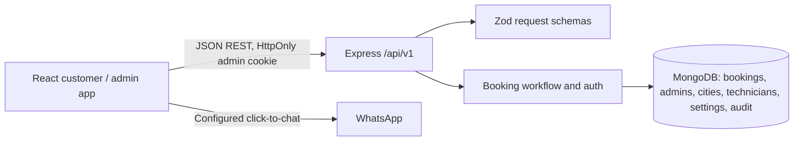
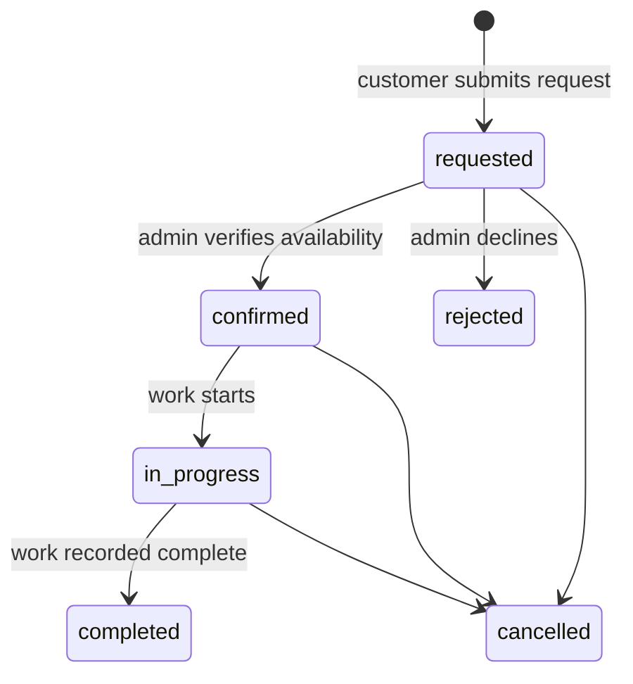

# RamLax Home Appliance Services

A TypeScript monorepo for customer service requests and a protected operations dashboard. The web app uses React, Vite, React Router, TanStack Query, Axios and a responsive CSS design system. The API uses Express, MongoDB/Mongoose, Zod, Argon2id and short-lived HttpOnly admin cookies.

## Local setup

Requirements: Node.js 20+, npm 10+, and a MongoDB instance (local or Atlas). From the repository root:

1. `npm install`
2. Copy `apps/api/.env.example` to `apps/api/.env` and set `MONGODB_URI`, `JWT_SECRET` and `COOKIE_SECRET` (both secrets must be at least 32 characters). Contact settings are optional and start unset.
3. Copy `apps/web/.env.example` to `apps/web/.env` if the API is not at `http://localhost:4000/api/v1`.
4. Run `npm run dev` to start API at port 4000 and web at port 5173.
5. Create the first administrator by setting `ADMIN_EMAIL` and `ADMIN_PASSWORD` in the API environment (password must be at least 12 characters), then run `npm run bootstrap:admin`. Bootstrap refuses to run once an administrator exists.
6. Sign in at `/admin/login`.

On first API startup, four appliance service categories and their standard request types are inserted when absent. Their initial prices require a quote, and no location rules are enabled. Sign in and open **Locations** to configure real coverage, then **Services and pricing** to set each service type's price mode and coverage. Coverage examples use `bengaluru:Indiranagar|Koramangala, mysuru:*`; `*` enables all configured areas in that city. Add real business phone, WhatsApp, email and address in **Business settings** before publishing contact links. Do not enable a city or price until the business has confirmed it.

## Scripts

- `npm run dev` — concurrent API and web development servers
- `npm run build` — build each workspace
- `npm run typecheck` — strict TypeScript checks
- `npm test` — workspace unit tests
- `npm run bootstrap:admin` — one-time environment-driven owner creation

## Architecture

Booking preferences and confirmed appointment fields are separate. The current app does not assign a confirmed slot automatically. Services, service types and price configuration are stored in MongoDB; bookings save a server-calculated snapshot including fixed/starting price and configured additional charges. No payment provider is enabled. Technician assignment is validated against active status, skill, city and area.

## API overview

Base path `/api/v1`. Responses use `{ data }` or `{ error: { code, message } }`.

- Public: `GET /services`, `GET /services/:slug`, `GET /locations`, `GET /locations/:slug`, `GET /settings/public`, `POST /bookings`, `POST /bookings/lookup`, `POST /reviews`, `GET /reviews`, `POST /contact`
- Auth: `POST /auth/login`, `POST /auth/logout`, `GET /auth/me`
- Admin: `GET /admin/dashboard`, `GET /admin/bookings`, `GET /admin/bookings/:id`, `PATCH /admin/bookings/:id/status`, `PATCH /admin/bookings/:id/schedule`, `PATCH /admin/bookings/:id/assignment`, `PATCH /admin/bookings/:id/payment`, `GET /admin/reviews`, `PATCH /admin/reviews/:id`, `GET /admin/reports`, `GET /admin/notifications`, `GET|POST /admin/services`, `PATCH|DELETE /admin/services/:id`, `GET|POST /admin/services/:id/types`, `PATCH|DELETE /admin/services/:id/types/:typeId`, `GET /admin/contacts`, `GET|POST /admin/cities`, `GET|POST /admin/technicians`, `PATCH /admin/settings`, `GET /admin/audit-logs`
- Health: `/health`, `/ready`

Booking submissions require a random `Idempotency-Key`, validate active service types, city/area coverage, configured appointment windows and date horizon, then save server-calculated price snapshots. The response contains an access key; customers need both that key and the booking reference for privacy-safe lookup. Fixed prices include configured additional charges; starting prices remain estimates; quote prices do not invent a total. Reviews require the same access key and a completed booking, and remain private until approved. API credentials are never sent to the browser.

## Environment variables

API: `NODE_ENV`, `PORT`, `MONGODB_URI`, comma-separated `WEB_ORIGIN`, `JWT_SECRET`, `COOKIE_SECRET`, `BUSINESS_TIME_ZONE` (defaults to `Asia/Kolkata`), `BUSINESS_PHONE`, `BUSINESS_WHATSAPP_PHONE`, `BUSINESS_EMAIL`, `BUSINESS_ADDRESS`, `ADMIN_EMAIL`, `ADMIN_PASSWORD`, optional `LOG_LEVEL`.

Web: `VITE_API_URL`. Set API origins and frontend origin consistently for deployment. Use HTTPS in production so the administrator cookie is Secure. Keep secrets in the host secret manager; never commit `.env` files.

## Deployment

- **Web (Vercel):** create a Vercel project with root directory `apps/web`. Configure `VITE_API_URL` as the API deployment origin plus `/api/v1`. The Vite app's `vercel.json` falls back to `index.html` for client-side routes so direct links and refreshes work.
- **API (Vercel):** create a second Vercel project from the same repository with root directory `apps/api`. Keep **Include source files outside the Root Directory** enabled so the npm workspace can access `packages/shared`; the included `apps/api/vercel.json` runs the API build. Vercel detects the Express function from `src/server.ts`.
- Set API Production and Preview environment variables in Vercel: `MONGODB_URI`, a unique random `JWT_SECRET` of at least 32 characters, a unique random `COOKIE_SECRET`, exact HTTPS frontend origin(s) in comma-separated `WEB_ORIGIN` with no trailing slash, and `BUSINESS_TIME_ZONE`. Add optional business contact values as needed. Vercel supplies `NODE_ENV`; do not set a long-running `PORT` server for Functions.
- Confirm the MongoDB Atlas network access rules permit the Vercel deployment to connect. Then redeploy both projects so the web build receives the current `VITE_API_URL` and the API receives its environment values.
- API diagnostics: `/` describes the API, `/api/v1/health` reports the runtime mode, and `/ready` checks MongoDB connectivity and catalog initialization.
- Service photos: admins can upload separate JPG, PNG, or WEBP card and gallery images (up to 1 MB each) from Services and pricing. Image bytes and duplicate-detection hashes are stored with the service in MongoDB; public service APIs expose image URLs and never include the binary bytes in JSON. If an uploaded image is absent, the website uses distinct appliance-specific stock fallbacks.
- Vercel Functions cannot host WebSocket connections. The API disables Socket.IO on Vercel and the admin dashboard falls back to 15-second polling; a persistent Node host is needed for Socket.IO push updates.
- Restrict admin dashboard accounts through the one-time bootstrap; never expose database or provider credentials in Vite variables.

## Development notes and limitations

There is no preconfigured service territory, business contact information, approved customer review, active service-area rule, or administrator credential in the repository; these remain unavailable until an owner configures them. WhatsApp click-to-chat appears when a number is configured. Contact submissions are stored and listed through the admin API. Internal event notifications, review submission/moderation and database-aggregated reports are implemented. External email/SMS/WhatsApp delivery and payments remain disabled. Password recovery delivery, refresh-token rotation, technician editing/deactivation, payment-entry UI, and deeper report UX remain outstanding. Automated tests currently cover catalog/status contracts and price snapshots only; isolated database-backed API tests and Playwright end-to-end workflows are not yet present.

Schema notes: bookings snapshot customer-entered service/location details and requested time; indexes support public references, status, and customer history. MongoDB transactions are not required by current single-document status changes. If a future workflow mutates multiple records atomically, use a replica-set deployment such as Atlas.
